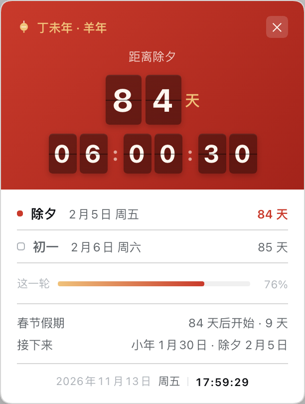

# dsh-spring-countdown

过年倒计时插件，给 DeepSeek Harness 桌面端左侧栏加一个「倒计时」入口，并向模型暴露一个查询工具。



## 它做什么

**左侧栏入口**（`sidebar.footer.action` 席位，设置按钮上方）

- 宽态：红灯笼图标 + 「倒计时」+ 距除夕天数徽章
- 折叠成 56px rail 时只留图标，不挤压布局
- 点开是一张浮层卡片，每秒刷新，`Esc` 或点外部关闭

**面板内容**

- 主目标：距除夕的天数与 `时:分:秒`，**机场翻牌器（split-flap）样式**，每次数值变化翻一次牌
- 两个目标并列：除夕（腊月廿九）、正月初一，各自日期、星期、天数
- 这一轮春节进度条：上一个春节 → 下一个春节之间走过的比例
- 春节假期：未开始 / 第 N 天 · 还剩 M 天 / 已结束
- 接下来：小年、元宵等最近节点
- 底部实时显示当前「年月日 星期 时分秒」，每秒刷新

**模型工具** `spring_festival_countdown`

用户问「还有多久过年」「离除夕几天」「春节放几天假」时模型会调它，返回结构化数据和一张终端卡片：

```
🧧 2027 丁未年 · 羊年 · 春节倒计时

  除夕  2027-02-05 周五 · 腊月廿九
        还有 84 天 7 小时 20 分 00 秒
  初一  2027-02-06 周六 · 正月初一
        还有 85 天 7 小时 20 分 00 秒

  这一轮春节已过 ▓▓▓▓▓▓▓▓▓▓▓▓▓▓░░░░ 76%

  · 下一个节点 小年 1月30日（78 天后）
  · 假期 2027-02-05 ~ 2027-02-13（9 天），84 天后开始
```

参数：`timezone`（IANA 时区，默认 `Asia/Shanghai`）、`at`（ISO 时间点，默认此刻）。

## 日期口径

- **春节日期表**：2000–2050 年，以 [lunar-javascript](https://github.com/6tail/lunar-javascript) 为准，并与国务院办公厅《关于 2027 年部分节假日安排的通知》交叉校验（2027-02-05 除夕、2027-02-06 正月初一）。
- **不要用 `Intl` 的 chinese 日历反推春节**：ICU 在 2027、2030 等年份与权威历书差一天，实测 2027 会算成 02-07。这一点在 `test/lunar.test.mjs` 里锁死了。
- **假期**：2027 年用官方口径（除夕至正月初八，9 天）；其他年份没有公开数据，按「除夕至正月初七」8 天估算，输出里 `estimated: true` 标注。
- **周期归属**：一个春节周期活到假期结束，而不是到初一为止 —— 正月初三的人看到的是「假期第 3 天，还剩 5 天」，不是「距下个春节 358 天」。
- **时区**：宿主端按 `timezone` 参数计算当地日历日；客户端按浏览器本地时区计算，两者春节日期表共用一份（`test/consistency.test.mjs` 守住不分叉）。

## 翻牌器怎么做的

宿主只提供 `react` 与 `react-dom`，没有动画库可用，所以翻牌是纯 CSS 3D：

- 每位数字一张牌。牌分上下两半（各占 50% 高、`overflow: hidden`），数字按整牌高度排版，下半再用 `margin-top: -height/2` 顶进视窗 —— 两半能严丝合缝拼回同一个数字。
- 静止时上半显示当前值、下半也显示当前值。
- 值变化时挂上两个动画层：旧值的上半 `rotateX(0 → -90deg)` 翻下去（`transform-origin: bottom`），新值的下半 `rotateX(90 → 0)` 延迟半个周期翻上来（`transform-origin: top`）。总时长 300ms，两段各 150ms。
- `animation-fill-mode: both` 让下层在延迟期间保持 90°（透明），不会提前露出来。
- 只有值真的变了才翻：秒位每秒一次，分位每分钟一次，时位每小时一次；天位一天一次，多数时候不翻。

牌面用半透明深色叠在红色渐变上，所以能透出背景红色，比实心色更融合。

## 目录

```
dsh-spring-countdown/
├── package.json          # dsh.bundle + dsh.client 声明
├── cordis.patch.yml      # bundle patch 层
├── lib/
│   ├── lunar.js          # 计算层：日期表、干支、倒计时、假期、卡片渲染
│   ├── index.js          # 宿主端：注册 spring_festival_countdown 工具
│   └── client.js         # 浏览器端：侧栏入口 + 面板（ModuleLoader 格式）
├── test/
│   ├── lunar.test.mjs        # 11 项：日期表、干支、口径、边界、时区
│   └── consistency.test.mjs  # 4 项：两份日期表一致、模块包装、席位 id、依赖面
└── screenshots/
```

## 安装

**从 GitHub 仓库安装**（插件市场的一键安装走的也是这条）：

```bash
dsh plugin --profile desktop add github:ReGan520/dsh-spring-countdown
```

本包是纯 JS，没有构建步骤，不需要授权 `prepare` 脚本。

**给自己（要改代码）**：用 checkout 目录安装，改完重启即生效，不必重装。

```bash
dsh plugin --profile desktop add /绝对路径/dsh-spring-countdown
```

**发给别人**：打成 tarball，对方一条命令装完。

```bash
pnpm pack --pack-destination dist     # 产出 dist/dsh-spring-countdown-0.2.0.tgz
```

对方执行：

```bash
dsh plugin --profile desktop add ./dsh-spring-countdown-0.2.0.tgz
```

面向接收方的完整说明在 [INSTALL.md](INSTALL.md)，连同 tgz 一起发过去即可。

装完都要**重启桌面端**（bundle 变更不会热重载）。

卸载：

```bash
dsh plugin --profile desktop remove dsh-spring-countdown
```

### 为什么发 tarball 而不是 git 仓库

git 安装拉的是源码不是产物，pnpm 默认拒绝跑 `prepare` 构建脚本，需要用户额外授权 —— 那等于允许陌生代码在安装时于本机执行。tarball 是预构建产物，装什么就是什么，可以解开看，也不需要任何构建权限。

## 本地调试（不安装）

用绝对路径的临时覆盖层挂宿主端，宿主端改动即时可见；客户端部分仍建议装进 profile，因为 `dsh.client` 依赖包清单。

```yaml
# scratch.yml
- insert:
    - id: spring-countdown
      name: '/绝对路径/dsh-spring-countdown/lib/index.js'
```

```bash
dsh web --patch ./scratch.yml
```

## 测试

```bash
npm test    # node --test，15 项，无外部依赖
```

## 已知限制

- 春节表止于 2050 年，超出会抛明确错误而不是瞎猜。
- 只有 2027 年的假期是官方数据，其他年份标注为估算。
- 面板是自定义浮层，没有复用 DSH 的 Menu / Popover 原语，是为了不依赖 `dsh-client-ui-primitives` 的内部导出；代价是外观不会跟随宿主主题的圆角与密度设置。
- 未做多语言，文案硬编码简体中文。
